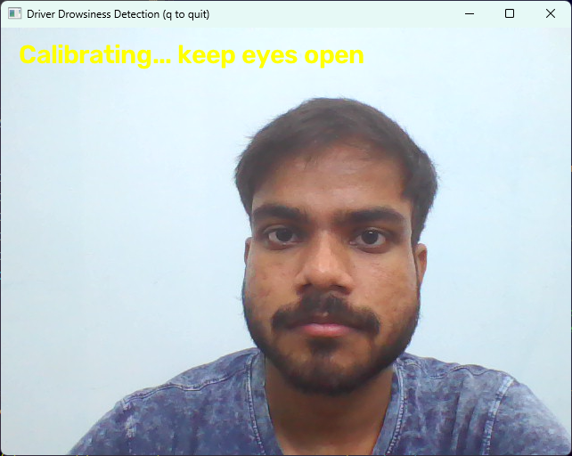
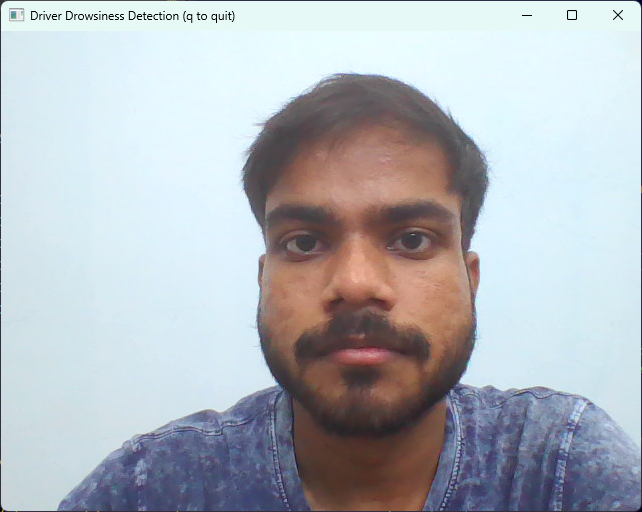
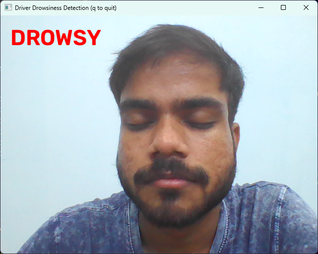
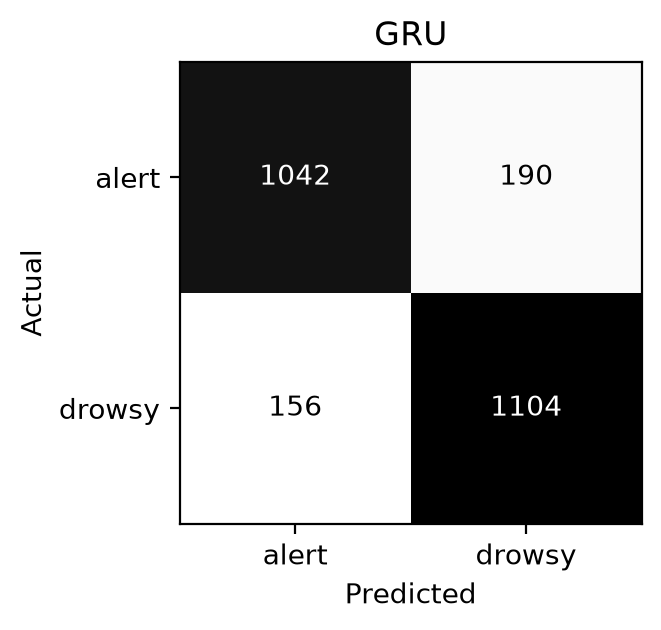
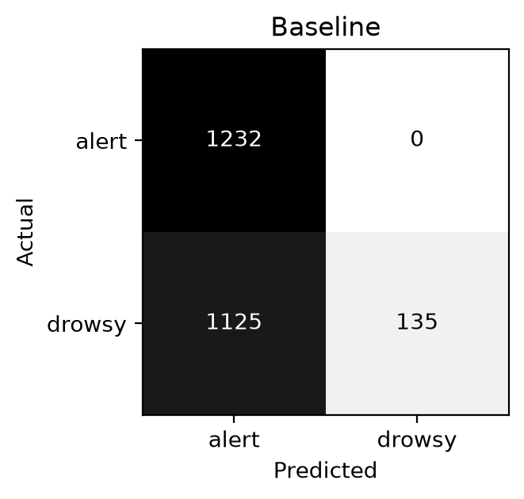
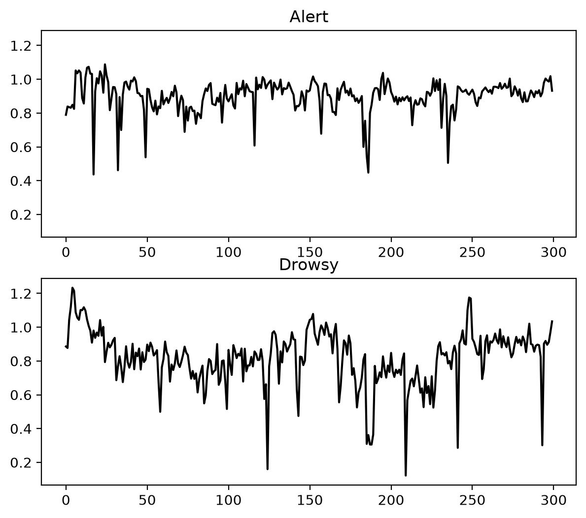

# Driver Drowsiness Detection

Real-time driver drowsiness detection using only a webcam. [MediaPipe Face Mesh](https://ai.google.dev/edge/mediapipe/solutions/vision/face_landmarker) extracts eye and mouth measurements from every frame, and a small GRU network classifies 30-frame windows of those measurements as **alert** or **drowsy**. A `DROWSY` warning is drawn on the video when two consecutive checks agree.

| Calibrating | Alert | Drowsy |
|---|---|---|
|  |  |  |

- Runs on a laptop CPU, no GPU needed (about 24 FPS on an Intel Core i3-1125G4)
- 28,897-parameter model, trains in under 5 minutes
- Evaluated only on people the model never saw during training
- Compared against a fixed-threshold rule so the benefit of learning is measured, not assumed

## How it works

```
Webcam → Face Mesh → EAR + MAR → per-driver normalization → 30-frame window → GRU → warning
```

1. **Landmarks.** MediaPipe Face Mesh returns 468 landmarks per frame. Only 14 are used: six around each eye and four around the mouth.
2. **EAR and MAR.**
   - Eye Aspect Ratio (EAR) = (‖p₂−p₆‖ + ‖p₃−p₅‖) / (2‖p₁−p₄‖), averaged over both eyes. It drops when the eyes close.
   - Mouth Aspect Ratio (MAR) = mouth opening / mouth width. It rises during a yawn.
3. **Per-driver normalization.** Open-eye EAR differs between people (for example 0.25 vs 0.32), so EAR is divided by the person's own 90th-percentile EAR. In the live app this level is measured during a calibration period of 450 face frames at the start.
4. **Windows.** Values are cut into windows of 30 frames, moving forward 5 frames at a time. A training window is labeled drowsy if more than half of its frames are.
5. **GRU.** One GRU layer (96 units) and a single sigmoid unit output the probability that the window is drowsy.
6. **Decision.** The warning appears when two predictions in a row exceed 0.5. One alert prediction resets the count, which avoids false alarms from a single odd window.

## Results

Evaluated on five held-out people (`x`, `y`, `za`, `zb`, `zc`): 2,492 windows, 1,232 alert and 1,260 drowsy. The final model uses window 30, step 5, GRU 96 units, 30 epochs and batch size 32.

| Class | Precision | Recall | F1-score | Support |
|---|---|---|---|---|
| Alert | 0.87 | 0.85 | 0.86 | 1,232 |
| Drowsy | 0.85 | 0.88 | 0.86 | 1,260 |
| Accuracy | | | 0.86 | 2,492 |

| GRU model | Rule-based baseline |
|---|---|
|  |  |

The baseline calls a window drowsy if more than half of its frames have a normalized EAR below 0.7. It is almost never wrong when it fires (precision 1.00) but it finds only about 11% of the drowsy windows.



### What mattered

- **Per-driver normalization** was the biggest improvement. On unseen people, drowsy recall rose from 0.39 to 0.84 and macro F1 from 0.65 to 0.87 (window 45, step 10).
- **Person-wise split.** Neighbouring windows from one person are nearly identical, so a random split of windows would leak. Whole people are held out instead.
- **Window size, step and GRU size** made little difference. Training the same setting four times gave drowsy recall between 0.73 and 0.90, which is as large as the gaps between settings.
- **Window 30** made the warning react in about half the time of window 60 (about 0.5 s).

## Repository contents

| Path | Purpose |
|---|---|
| `utils.py` | Landmark extraction, EAR and MAR functions, window settings |
| `convert_ddd.py` | Converts the DDD images into one `ear, mar, label` CSV per person |
| `train.py` | Person-wise split, normalization, windowing, GRU training, baseline comparison, model saving |
| `live.py` | Runs a saved model on the webcam |
| `make_figures.py` | Prints the reports and saves `confusion_gru.png`, `confusion_baseline.png` and `ear_plot.png` |
| `requirement.txt` | Python dependencies |
| `sessions_ddd/` | Output of `convert_ddd.py`: `ddd_<person>.csv` files |
| `*.keras` | Trained models (see [Model files](#model-files)) |
| `*.png` | Screenshots and figures used in this README |

<!-- script_testing.py is not described here: add one line for it in the table above. -->

## Setup

Tested with Python 3.12 on Windows 11.

```bash
git clone <repository-url>
cd <repository-folder>
pip install -r requirement.txt
```

Main libraries: TensorFlow 2.19.1, Keras 3.15.1, OpenCV, MediaPipe 0.10.14, NumPy, Pandas, scikit-learn 1.9.1, Matplotlib. The code uses the MediaPipe `mp.solutions` API, so keep MediaPipe on 0.10.x.

## Usage

### 1. Run a trained model

```bash
python live.py <model_file>.keras
```

Look at the camera with your eyes open for the first 15 to 20 seconds while it calibrates. Press `q` to quit.

`WINDOW_SIZE` in `utils.py` must match the `ws-` value in the model filename. The default is 30, which suits every model here except the `ws-60` ones.

### 2. Train your own model

Download the [Driver Drowsiness Dataset (DDD)](https://www.kaggle.com/datasets/ismailnasri20/driver-drowsiness-dataset-ddd) from Kaggle and extract it next to the scripts as `Driver Drowsiness Dataset (DDD)/` with its `Drowsy` and `Non Drowsy` folders.

```bash
python convert_ddd.py     # about 15-20 minutes for 41,793 images; creates sessions_ddd/ddd_<person>.csv
python train.py           # prints GRU and baseline reports, then saves the model
```

Window size and step are set in `utils.py`. GRU units, epochs and batch size are set at the top of `train.py`.

### 3. Recreate the figures

Set `MODEL_PATH` at the top of `make_figures.py` to a model file, then:

```bash
python make_figures.py
```

## Model files

The metrics are stored in each model's filename, so every number can be traced to a saved model:

```
1794377878_ddd_ws-30_step-5_gru-96_ep-30_bs-32_alert-p0.87-r0.85-f10.86-n1232_drowsy-p0.85-r0.88-f10.86-n1260.keras
```

| Part | Meaning |
|---|---|
| `1794377878` | Training timestamp |
| `ws`, `step` | Window size and step, in frames |
| `gru`, `ep`, `bs` | GRU units, epochs, batch size |
| `alert-…`, `drowsy-…` | Precision (`p`), recall (`r`), F1 (`f1`) and number of test windows (`n`) for each class on the held-out people |

The model used in the screenshots is `1794377878_…` (window 30, step 5, GRU 96).

## Limitations

- Results depend on the driver. In one experiment drowsy recall was 0.00 for one person and 0.50 for two others, probably because their drowsiness is not visible in eye and mouth measurements alone (for example when the head droops and the eyes stay open).
- Only eye and mouth measurements are used. Head pose and gaze are not.
- Trained on one public dataset (26 usable people), so other cameras and lighting may give different results.
- Persons `f` and `t` have only drowsy frames and are skipped in training, because their open-eye level cannot be estimated.
- The warning is shown on screen only, with no sound.
- This is a study and demonstration project, not a certified safety product. Do not rely on it while driving.

## Ideas for improvement

- Record data with a real in-car webcam
- Add head pose and gaze features
- Add an audible alert
- Cross-validate over all people and compare with LSTM or transformer models
- Support night driving with an infrared camera, or run on an embedded board

## Acknowledgements and references

- **Dataset:** Nasri, I. *Driver Drowsiness Dataset (DDD)*, Kaggle. Cropped faces from the Real-Life Drowsiness Dataset videos. If you use it, please cite: Nasri, I., Karrouchi, M., Snoussi, H., Kassmi, K., & Messaoudi, A. (2022). Detection and prediction of driver drowsiness for the prevention of road accidents using deep neural networks techniques. In *WITS 2020*. Springer. https://doi.org/10.1007/978-981-33-6893-4_6
- **Source videos:** Ghoddoosian, R., Galib, M., & Athitsos, V. (2019). A realistic dataset and baseline temporal model for early drowsiness detection. *CVPR Workshops*.
- **EAR:** Soukupová, T., & Čech, J. (2016). Real-time eye blink detection using facial landmarks. *Computer Vision Winter Workshop*.
- **Face Mesh:** Kartynnik, Y., et al. (2019). Real-time facial surface geometry from monocular video on mobile GPUs. https://arxiv.org/abs/1907.06724
- **GRU:** Cho, K., et al. (2014). Learning phrase representations using RNN encoder–decoder for statistical machine translation. *EMNLP*.